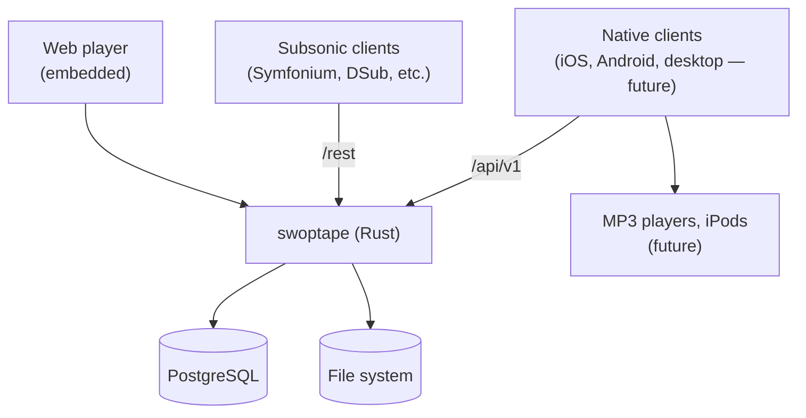

# swoptape: Architecture

swoptape is being rewritten in Rust ([ADR-0001](https://github.com/swopstar/meta/blob/main/adr/0001-rust.md)) on the
`rewrite/rust` branch. The Go implementation on `main` is kept as reference
until the rewrite reaches its MVP.

## Overview

## swoptape (Server)

A single Rust binary with the web player embedded, designed to run on
low-power ARM64 hardware. It exposes:

- `/api/v1` — the first-party API, used by the web player and native clients
- `/rest` — the Subsonic 1.16.1 API, for existing clients

### Key patterns

- **Single binary**: frontend assets embedded at compile time
- **File-first library**: folders (collections) are first-class records; tag
  views (artists, albums) are built from the same tracks
- **Streaming-first**: original files served directly; transcoding only on
  request, via `ffmpeg`
- **Subsonic compatibility**: both Subsonic browsing modes (folders and tags)
  backed directly by the library model

The design decisions are recorded in swoptape's
[ADRs](adr/):
workspace layout (T005), library model (T006), Subsonic authentication (T007),
API contract (T008) and the shared client core (T009).

---

## Native clients *(future)*

Native apps share a Rust client core (`swoptape-client`) holding the API
client, sync logic, download queue and offline database. The iOS app uses it
through UniFFI bindings, a native Android app will do the same, and the Tauri
desktop app calls it directly. See ADR-T009.
